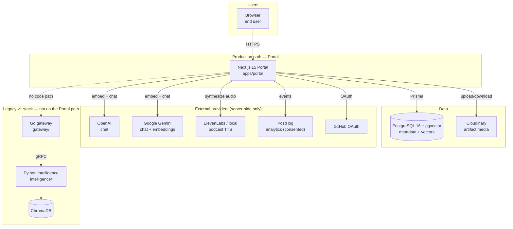
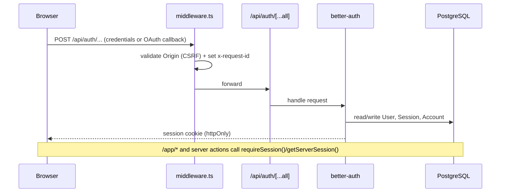
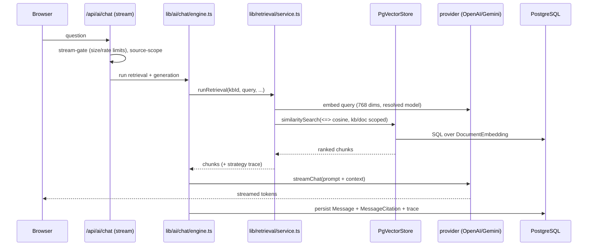
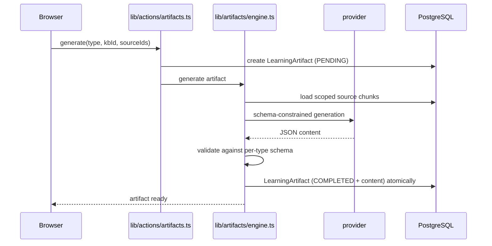
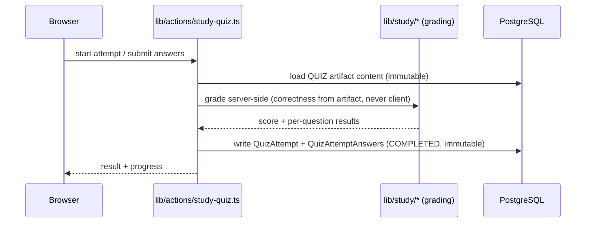
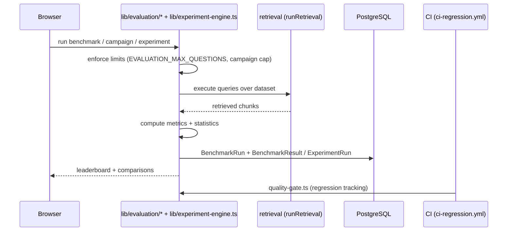
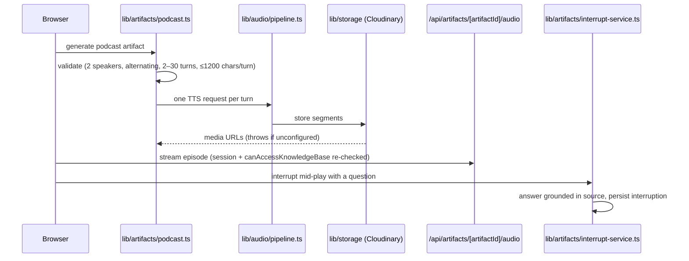
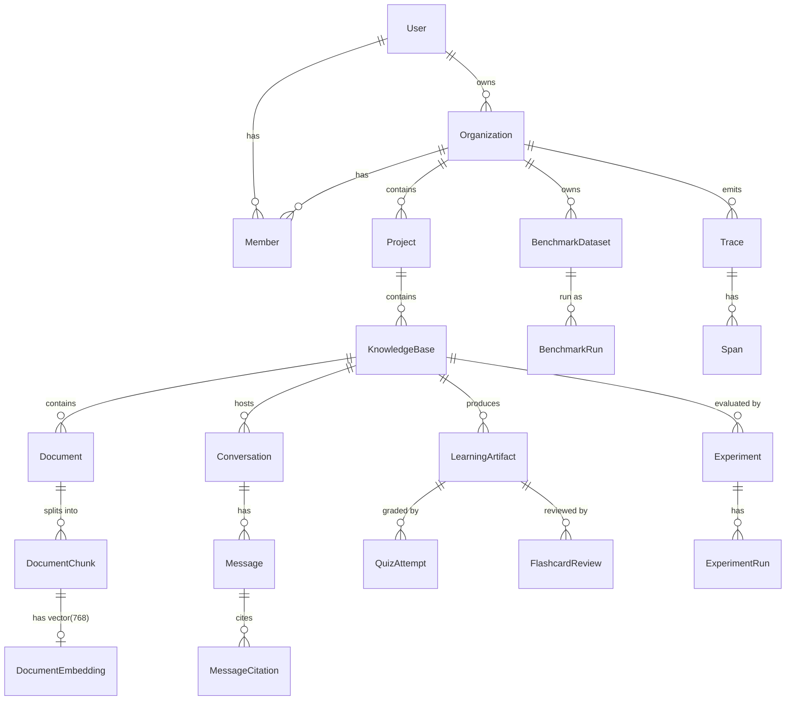

# Kairos — System Design

> **Status:** Canonical. This is the single source of truth for how Kairos is
> built and how it runs. Where another document disagrees with this one, this
> document wins and the other is either linked as detail or marked stale.
>
> **Last reconciled against:** commit `d3d1b663` (`feat(app): refine the studio
> and artifact detail surfaces`).
>
> **Scope:** the running system in this repository — the production Portal and
> the legacy v1 stack that ships alongside it.

`Ponytail note:` this document is descriptive, not aspirational. Statements are
labelled **Implemented**, **Partial**, **Planned**, or **Deprecated (legacy)**
so a reader can tell what is real today.

---

## Table of contents

- [A. Metadata and scope](#a-metadata-and-scope)
- [B. Executive summary](#b-executive-summary)
- [C. Architecture principles](#c-architecture-principles)
- [D. System context](#d-system-context)
- [E. Container and service architecture](#e-container-and-service-architecture)
- [F. Portal internals](#f-portal-internals)
- [G. Core sequence diagrams](#g-core-sequence-diagrams)
- [H. Data architecture](#h-data-architecture)
- [I. API and contract boundaries](#i-api-and-contract-boundaries)
- [J. AI and retrieval](#j-ai-and-retrieval)
- [K. Security and trust boundaries](#k-security-and-trust-boundaries)
- [L. Reliability and observability](#l-reliability-and-observability)
- [M. Deployment](#m-deployment)
- [N. Testing architecture](#n-testing-architecture)
- [O. Frontend and product alignment](#o-frontend-and-product-alignment)
- [P. Decision record (ADR-style)](#p-decision-record-adr-style)
- [Q. Risks and gaps](#q-risks-and-gaps)
- [Appendix: document map](#appendix-document-map)

---

## A. Metadata and scope

| Field | Value |
|-------|-------|
| Owner | Core platform maintainers |
| Status | Canonical, maintained by hand |
| Source of truth | The code in this repository; this doc cites it |
| Audience | Engineers onboarding, reviewers judging architecture, operators |
| Non-goals | Product roadmap (see `KAIROS_MASTER_PRODUCT_ROADMAP.md`), API reference (see `/docs` page), step-by-step deployment (see `DEPLOYMENT.md`) |

This document covers the **whole** repository, not just `apps/portal`. It exists
because the repository genuinely contains two stacks, and earlier docs described
one or the other without always saying which. Every section says which stack it
is describing.

How to keep it honest: when a change alters a boundary, a contract, or a trust
assumption, update the matching section here and cite the new path/symbol.
Details that belong to one subsystem should live in that subsystem's doc and be
linked, not duplicated.

---

## B. Executive summary

Kairos is an explainable AI research and learning workspace. Its central
hypothesis is that **different questions need different retrieval strategies**,
and that the retrieval decision should be inspectable.

The repository ships two stacks:

1. **The Portal** (`apps/portal/`) — **production**. A Next.js 15 / React 19
   application that owns ingestion, text extraction, chunking, embedding,
   vector storage, retrieval, generation, artifacts, study and evaluation **end
   to end**. It stores its vectors in **PostgreSQL + pgvector** alongside all
   other data, and it has **no code path to the gateway, the intelligence engine
   or ChromaDB**.
2. **The legacy v1 stack** (`gateway/`, `intelligence/`, ChromaDB) — **still in
   the repo, still runs under Docker Compose**, not on the Portal's path, not
   deleted. It is a Go gateway in front of a Python RAG engine with its own
   gRPC contract and its own vector store.

The key architectural facts a new engineer must internalise:

- **One vector contract.** `DocumentEmbedding.embedding` is a `vector(768)` column
  with an HNSW cosine index. Retrieval uses Gemini `text-embedding-004` (768
  dims). Ingestion refuses any non-768 model before calling a provider. The
  width is pinned in SQL, not in Prisma's datamodel.
- **One database.** PostgreSQL holds metadata *and* vectors; there is no
  separate vector service on the production path.
- **Scoped access, not DB row-level security.** `PgVectorStore` filters by
  knowledge-base/document id in the SQL similarity query, after the application
  has authorised access.
- **Pluggable providers, fixed embedding width.** Chat models are selectable
  (OpenAI or Gemini — see [Q. Risks](#q-risks-and-gaps) on the Ollama
  discrepancy); retrieval embeddings are a fixed contract.

---

## C. Architecture principles

1. **The Portal is self-contained.** If it needs a capability, it owns it.
   Cross-service hops are a liability, so the production path is one process and
   one database.
2. **The database pins the vector contract.** Prisma cannot express a pgvector
   typmod or an ANN index, so the migration and the live database are
   authoritative — never `schema.prisma`, never `prisma migrate diff`.
3. **Fail loudly at trust boundaries.** Missing Cloudinary credentials throw
   rather than silently writing to local disk; a wrong-width query embedding
   raises the two dimensions instead of returning "no results"; oversized
   evaluation datasets are refused with `413` before a run row exists.
4. **Tenant isolation is structural.** Every resource hangs off an organization;
   foreign tenants get `404`, not `403`, so resource existence is not leaked.
5. **Explainability is a feature, not an afterthought.** Conversations persist
   citations and a retrieval trace; artifacts record their source ids;
   observability is modelled in the schema (`Trace`, `Span`, `CostRecord`,
   `DriftAlert`, `Incident`).
6. **Smallest working change.** Deletion over addition, no new dependency when a
   standard library or an installed package covers it, no abstraction nobody
   asked for.
7. **Legacy is quarantined, not hidden.** The v1 stack stays runnable and stays
   labelled. Nothing on the Portal path depends on it.

---

## D. System context

Who talks to what, at the highest level. The Portal and the legacy stack share a
PostgreSQL instance only in local Compose (the v1 engine writes its own tables);
at runtime they do not call each other.



**Implemented (Portal path):** browser → Portal → PostgreSQL/pgvector, Cloudinary,
OpenAI/Gemini, ElevenLabs/local TTS, PostHog, GitHub OAuth.
**Deprecated (legacy):** SDK/clients → Go gateway → Python intelligence → ChromaDB.
The dotted edge is deliberate: the Portal never calls it.

Evidence: `docker-compose.yml` (services `postgres`, `chromadb`, `intelligence`,
`gateway`, `prometheus`, `grafana` — **no portal service**); `apps/portal/src`
(the only directory under `apps/`); the portal's CSP `connect-src` in
`apps/portal/next.config.ts`.

---

## E. Container and service architecture

### E.1 Production container: the Portal

`apps/portal` is a single Next.js process. It is deployed with
`output: 'standalone'` and `outputFileTracingRoot` pointed two levels up
(`apps/portal/next.config.ts`) so the monorepo root is the tracing root.

| Concern | Location |
|---------|----------|
| App Router routes (pages) | `apps/portal/src/app/**/page.tsx` |
| Route handlers (HTTP API) | `apps/portal/src/app/**/route.ts` |
| Server actions | `apps/portal/src/lib/actions/*` |
| Domain libraries | `apps/portal/src/lib/*` |
| Data access | `apps/portal/src/lib/prisma.ts`, `apps/portal/prisma/` |
| Request middleware | `apps/portal/src/middleware.ts` |
| Auth adapter | `apps/portal/src/auth.ts` → `lib/server/auth-utils.ts` |

### E.2 Supporting services (Docker Compose)

`docker-compose.yml` defines six services. Only `postgres` and (in production
for some teams) `prometheus`/`grafana` are relevant to a Portal deployment; the
rest are the legacy stack.

| Service | Image / build | Ports | Stack | Role |
|---------|---------------|-------|-------|------|
| `postgres` | `pgvector/pgvector:pg16` | 5432 | shared | App DB + production vector store; `max_connections=300` |
| `chromadb` | `chromadb/chroma:1.0.15` | 7777→8000 | legacy v1 | v1 vector store |
| `intelligence` | `docker/intelligence.Dockerfile` | 28080, 8001 (loopback) | legacy v1 | Python RAG engine (gRPC + metrics) |
| `gateway` | `docker/gateway.Dockerfile` | 8080 | legacy v1 | Go HTTP API gateway |
| `prometheus` | `prom/prometheus:v2.51.0` | 9090 | v1 observability | Scrapes gateway + intelligence |
| `grafana` | `grafana/grafana:10.4.2` | 3000 | v1 observability | Dashboards (port conflicts with a local Portal) |

The Portal is run locally with `npm run dev` (port 3000) and deployed separately
(see [M. Deployment](#m-deployment)). It is **not** in the compose file.

---

## F. Portal internals

### F.1 Route surfaces

The App Router is organised into three groups plus the API:

- **`(marketing)`** — public: `/`, `/features`, `/capabilities`, `/about`,
  `/blog`, `/changelog`, `/docs`, `/privacy`, `/terms`, `/security`.
- **`(auth)`** — `/login`, `/signup`. Public and optional; an account is never
  required to use the workspace.
- **`/app`** — the workspace, usable without an account. When a visitor has no
  session the layout bootstraps an isolated anonymous session via
  `GET /api/session` (see [F.2](#f2-middleware)) instead of redirecting to
  `/login`. Top-level tools include
  `/app/knowledge-bases`, `/app/research`, `/app/studio`, `/app/study`,
  `/app/evaluation`, `/app/leaderboards`, `/app/datasets`, `/app/prompts`,
  `/app/planner`, `/app/experiment-builder`, `/app/rag-chat`, `/app/copilot`,
  `/app/retrieval-lab`, `/app/model-comparison`, `/app/chunking-studio`,
  `/app/lineage`, `/app/publication`, `/app/quality-gates`, `/app/regression`,
  `/app/analytics`, `/app/notebook`, `/app/reviews`, `/app/architecture`,
  `/app/project-guide`, `/app/advanced-retrieval`, `/app/benchmark-explorer`,
  `/app/settings/*`, `/app/observability/*`.
- **Knowledge-base workspace** — `/app/knowledge-bases/[kbId]` with nested
  `[docId]`, `chat`, `studio`, `study`, `artifacts/[artifactId]`.

### F.2 Middleware

`apps/portal/src/middleware.ts` does three things and nothing else:

1. Generates `x-request-id` (and echoes `x-response-time`) on every response.
2. **CSRF defence:** for state-changing methods (`POST/PUT/PATCH/DELETE`), it
   validates that the `Origin` header matches `Host` (or is localhost in dev),
   returning `403` on mismatch. Requests to `/api/v1/*` carrying an `x-api-key`
   skip this because they use API-key auth.
3. Matches everything except static assets.

It does **not** enforce authentication. Route/action-level checks do that.

Authentication is never a hard barrier: the `/app` layout resolves a session
and, when there is none, redirects once to `GET /api/session`, which issues an
anonymous session through the Better Auth `anonymous` plugin (isolated to the
visitor's own auto-provisioned organization) and returns them to `/app`.
Registered accounts are optional and only upgrade an anonymous session; the
plugin is configured with `disableDeleteAnonymousUser` so an anonymous
visitor's work is never destroyed on sign-up.

### F.3 Application layers

```text
Browser
  │  fetch / form submit
  ▼
Next.js App Router (page.tsx, route.ts)          ← renders + validates
  │
  ├─ Server Actions  lib/actions/*               ← authenticated mutations
  ├─ Domain libs     lib/{ai,retrieval,artifacts,study,evaluation,ingestion,...}
  │
  ▼
Prisma Client (lib/prisma.ts) ──► PostgreSQL + pgvector
```

Representative modules:

| Domain | Modules |
|--------|---------|
| AI providers | `lib/ai/providers/{index,openai,gemini,types}.ts` |
| Chat engine | `lib/ai/chat/engine.ts`, `stream-markers.ts`, `stream-gate.ts`, `source-scope.ts`, `access.ts` |
| Retrieval | `lib/retrieval/{service,strategies/*,debugger/*,embedding-models}.ts` |
| Vector store | `lib/vector/store.ts` (`PgVectorStore`) |
| Ingestion | `lib/actions/document.ts`, `lib/ingestion/{text,url,youtube}.ts`, `lib/extraction/parsers.ts` |
| Artifacts | `lib/artifacts/*` (one module per type + `engine.ts`, `persistence.ts`) |
| Audio/podcast | `lib/audio/{pipeline,playback,assembly,providers/*}.ts`, `lib/artifacts/interrupt-service.ts` |
| Study | `lib/study/*` |
| Evaluation | `lib/evaluation/*`, `lib/experiment-planner/*`, `lib/experiment-engine.ts` |
| Observability | `lib/telemetry/*`, `lib/actions/observability.ts` |
| Authz | `lib/rbac.ts`, `lib/organizations.ts`, `lib/server/{organization,workspace,demo-user}.ts` |

### F.4 Component layer

`apps/portal/src/components` is split into `marketing/`, `app/`, `ui/`,
`evaluation/`, `research/`, `observability/`, `enterprise/`, `auth/`, `shared/`.
The `app/` tree mirrors the workspace: `studio/` (artifact viewers per type),
`explainability/` (retrieval inspector, prompt inspector, citation inspector),
`study/`, `home/`, plus shell components (`sidebar.tsx`, `app-header.tsx`,
`breadcrumbs.tsx`, `kb-workspace-tabs.tsx`).

---

## G. Core sequence diagrams

### G.1 Authentication (better-auth)



`apps/portal/src/auth.ts` re-exports `getServerSession` and wraps
`requireSession` from `lib/server/auth-utils.ts`. Session/Account/Verification
tables are better-auth core (`schema.prisma`).

### G.2 Ingestion (upload → indexed)

```mermaid
sequenceDiagram
    participant B as Browser
    participant KB as lib/actions/document.ts
    participant EX as lib/extraction/parsers.ts
    participant IA as lib/ai (embedding)
    participant VS as PgVectorStore
    participant DB as PostgreSQL + pgvector

    B->>KB: upload file / add text / URL / YouTube
    KB->>KB: validate type + size (ALLOWED_EXTENSIONS, MAX_FILE_SIZE=10MB)
    KB->>EX: extract text
    EX-->>KB: text + metadata
    KB->>KB: chunk
    KB->>IA: embed each chunk (768-dim; assertIndexableEmbeddingModel)
    IA-->>KB: vectors
    KB->>DB: write Document + DocumentChunk + DocumentEmbedding (tx)
    KB->>VS: bulkUpsertEmbeddings()
    KB-->>B: status → INDEXED
```

Document status is a state machine: `QUEUED → UPLOADING → STORED → EXTRACTING →
CHUNKING → EMBEDDING_PENDING → EMBEDDING → INDEXED → READY` (or `ERROR`)
(`DocumentStatus` in `schema.prisma`).

### G.3 Research chat (retrieve → generate → cite)



The embedding provider/model is resolved in one place
(`resolveEmbeddingModel`, `lib/retrieval/embedding-models.ts`) so a query is
never embedded with a different model than the documents it searches.

### G.4 Artifact generation



Seven artifact types: `SUMMARY, REPORT, QUIZ, FLASHCARDS, MINDMAP, TAKEAWAYS,
PODCAST` (`ArtifactType`). Each has a generator module and a viewer component. A
failure records `FAILED` atomically rather than a partial content blob.

### G.5 Study loop (quiz + flashcards)



Flashcards follow a deliberate deterministic `NEW → LEARNING → KNOWN`
progression with a KNOWN card answered "Again" dropping back to LEARNING — no
spaced-repetition scheduler (`FlashcardReview`).

### G.6 Evaluation and regression



### G.7 Podcast (script → per-turn TTS → grounded interruption)



Synthesis is **per turn**, so a long episode cannot exceed a provider request
limit, and a failure never invalidates the generated script. The audio route
re-checks organization membership per request — it never trusts the URL.

---

## H. Data architecture

### H.1 Storage model

- **One store for everything:** PostgreSQL 16 with the `vector` extension.
- **Schema owner:** `apps/portal/prisma/schema.prisma` — 60 models, 22 enums,
  21 migration directories under `apps/portal/prisma/migrations/`.
- **Client:** `apps/portal/src/lib/prisma.ts` (singleton).
- **Seed:** `apps/portal/prisma/seed.ts`.

### H.2 The vector contract (authoritative)

| Concern | Value | Authoritative source |
|---------|-------|----------------------|
| Extension | `vector` | migration `20260913000000_add_embedding_vectors` |
| Column | `DocumentEmbedding.embedding vector(768)` | migration `20261122000000_pin_embedding_dimension_768` |
| Index | HNSW, `vector_cosine_ops`, `m=16`, `ef_construction=64` | same migration |
| Prisma view | `Unsupported("vector")?` (typmod-less, no index) | `schema.prisma` |
| Retrieval model | `gemini/text-embedding-004`, 768 dims | `lib/retrieval/embedding-models.ts` |

Prisma's datamodel cannot express the typmod or the index, so
`prisma migrate diff` against a live database **will always show drift** on this
column. That is expected. Do not "fix" it in `schema.prisma`.

### H.3 Core relationship chain



Every resource chains to an `Organization` through
`Organization → Project → KnowledgeBase → …` (or directly, for org-scoped
tables). Access checks verify membership in that chain; see
[K. Security](#k-security-and-trust-boundaries).

### H.4 Data classes

| Class | Models | Notes |
|-------|--------|-------|
| Identity | `User`, `Session`, `Account`, `Verification` | better-auth core |
| Tenancy | `Organization`, `Member`, `Invitation`, `Project`, `WorkspaceSettings`, `ShareLink` | `MemberRole`: OWNER/ADMIN/MEMBER/VIEWER |
| Knowledge | `KnowledgeBase`, `Document`, `DocumentChunk`, `DocumentEmbedding`, `DocumentVersion`, `DocumentActivity` | ingestion state machine |
| Conversation | `Conversation`, `Message`, `MessageCitation` | citations + trace persisted per message |
| Artifacts | `LearningArtifact` | 7 types; content is JSON validated per type |
| Study | `QuizAttempt`, `QuizAttemptAnswer`, `FlashcardReview` | server-graded, immutable attempts |
| Evaluation | `Experiment`, `ExperimentRun`, `ExperimentArtifact`, `BenchmarkDataset`, `BenchmarkQuestion`, `BenchmarkRun`, `BenchmarkResult`, `BenchmarkRegression`, `LeaderboardEntry` | statistics + leaderboard |
| Quality | `QualityGate`, `QualityGateResult`, `GoldenDataset`, `GoldenDatasetEntry`, `ReviewQueue`, `ReviewComment` | see risk Q4 (two gate systems) |
| Prompts | `PromptFolder`, `Prompt`, `PromptVersion` | prompt versioning |
| Ops | `Trace`, `Span`, `TraceEvent`, `CostRecord`, `DriftAlert`, `AlertRule`, `AlertEvent`, `Incident`, `IncidentEvent`, `ProviderHealth`, `PipelineRun`, `PipelineStep`, `TelemetryConfig` | observability + incidents |
| Governance | `ActivityLog`, `AuditLog`, `ApiKey`, `Notification` | audit/keys |

---

## I. API and contract boundaries

### I.1 Route handlers (HTTP)

| Route | Purpose | Auth |
|-------|---------|------|
| `GET /api/health`, `/api/health/ready`, `/api/health/live` | health + probes | none |
| `GET /api/metrics` | app metrics + deployment metadata | none |
| `ALL /api/auth/[...all]` | better-auth handler | n/a |
| `POST /api/ai/chat` | streaming RAG chat | session |
| `GET/POST /api/ai/conversations[/id]` | conversation CRUD | session |
| `GET /api/documents/[docId]/media` | Cloudinary media proxy (the only portal `fetch` to an external service) | session |
| `GET /api/artifacts/[artifactId]/audio` | podcast media (org re-checked) | session |
| `.../audio/interruption/[interruptionId]` | podcast interruption Q&A | session |
| `GET /api/experiments/stream` | experiment run stream | session |
| `GET/POST /api/v1/*` | datasets, experiments (+runs), artifacts, compare, regression | **`x-api-key`** (`KAIROS_API_SECRET`) |
| `GET/POST /api/ai/settings` | provider/model settings | session |

`/api/v1/*` is the machine-facing surface. It is distinguished in middleware by
the `x-api-key` header and is not subject to the CSRF origin check.

### I.2 Server actions

Mutations from the UI go through server actions in `apps/portal/src/lib/actions/`
(`document`, `knowledge-base`, `artifacts`, `study-quiz`, `study-flashcards`,
`evaluation`, `organization`, `api-keys`, `prompts`, `retrieval-lab`,
`quality-gates`, `observability`, `incidents`, `alerts`, `cost`, `drift`,
`reviews`, `storage`, `notification`, `pipeline`, `provider-health`, …). Each
action re-derives the session user and authorises the resource — never trusting a
client-supplied id.

### I.3 Internal contracts

- **Provider interface** (`lib/ai/providers/types.ts`): `generateChat`,
  `streamChat`, `generateEmbedding`, `getDefaultModel`, `getAvailableModels`.
- **Retrieval strategy interface** (`lib/retrieval/strategies/types.ts`):
  `RetrievalStrategy.retrieve(ctx)`; composition via
  `executeRetrievalWithTrace` and `FullRetrievalTrace`.
- **Vector store interface** (`lib/vector/store.ts`): `bulkUpsertEmbeddings`,
  `similaritySearch`, `deleteEmbedding`, `deleteEmbeddingsByDocument`.

---

## J. AI and retrieval

### J.1 Providers

`lib/ai/providers/index.ts` is the factory:

- `getAIProvider(type?)` resolves `type → process.env.AI_PROVIDER → "openai"`.
- `getEmbeddingProvider(type?)` delegates to it.
- Implementations: `openai.ts`, `gemini.ts` (**only these two**).
- `isChatModelAllowed(provider, model)` rejects any model not in the resolved
  provider's known set, so a forged request field or stale stored model can never
  reach the LLM API.
- `resetAIProviderCache()` exists because SDK clients capture `globalThis.fetch`
  at construction.

`MAX_OUTPUT_TOKENS = 16384`, resolved via `AI_MAX_OUTPUT_TOKENS`
(`lib/ai/providers/types.ts`).

> **Discrepancy:** the README and some docs claim the Portal can generate through
> **Ollama**. The code has no Ollama chat provider. See risk [Q2](#q-risks-and-gaps).
> Audio TTS does have a `local` provider (`lib/audio/providers/local.ts`) plus
> ElevenLabs; that is separate from chat generation.

### J.2 Embedding contract

- Retrieval embeddings are **fixed at 768 dims**: `text-embedding-004` or
  `embedding-001`. `assertIndexableEmbeddingModel` rejects anything else before a
  provider call, because the pinned column cannot hold a wider vector.
- Resolution order: explicit override → knowledge base `retrievalConfig` → env,
  through the single `resolveEmbeddingModel`.
- Chat model and embedding model are independent settings; changing chat does not
  change embedding width (`CONFIGURATION.md`).

### J.3 Retrieval strategies

`lib/retrieval/strategies/index.ts`:

- Registry registers **vector**, **keyword** (BM25), **hybrid** (RRF).
- `executeRetrievalWithTrace` optionally composes, in order: query-expansion →
  multi-query → reranking → base strategy → context-compression, emitting a
  `StrategyStep` per stage with durations.
- Default strategy config is `hybrid` with `rrfK = 60`.
- Additional strategy modules exist (`bm25.ts`, `reranking.ts`,
  `query-expansion.ts`, `multi-query.ts`, `context-compression.ts`) and are wired
  through wrappers.

Search itself: `PgVectorStore.similaritySearch` runs
`1 - (embedding <=> $query) >= minSimilarity` ordered by cosine distance,
**scoped** by `knowledgeBaseIds`/`documentIds` and `Document.status = 'INDEXED'`.
A single-row dimension probe fails with the two widths if the query vector does
not match the stored rows.

### J.4 Traces and debugging

`lib/retrieval/debugger/*` provides `retrieval-trace`, `retrieval-comparison`,
`why-not-retrieved`, `similarity-heatmap`, `prompt-viewer`, `chunk-explorer` and
`citation-overlay`. These back the explainability components in
`components/app/explainability/`.

---

## K. Security and trust boundaries

### K.1 Trust boundaries

1. **Client ↔ server** — all traffic passes `middleware.ts` (request id, CSRF
   origin check) and route/action-level session validation.
2. **Server ↔ database** — Prisma parameterised queries; raw SQL in
   `PgVectorStore` binds values as parameters.
3. **Server ↔ providers** — OpenAI/Gemini/Cloudinary/TTS are called server-side
   only; keys never reach the client (`NEXT_PUBLIC_*` is audited).
4. **Tenant ↔ tenant** — structural isolation with `404` on cross-tenant access.

### K.2 Authentication and authorization

- Sessions via better-auth; `lib/server/auth-utils.ts` `requireSession()` /
  `getServerSession()`.
- RBAC in `lib/rbac.ts`; `MemberRole` = OWNER / ADMIN / MEMBER / VIEWER;
  `UserRole` = SUPERADMIN / ADMIN / USER.
- Every data access verifies authentication, organization membership, and
  resource existence.

### K.3 Request hardening

- **CSRF:** origin/host match for state-changing methods (except `/api/v1/*` with
  `x-api-key`).
- **Rate limiting:** in-memory sliding windows (`lib/rate-limit.ts`).
- **Uploads:** extension allowlist (`pdf,txt,md,markdown,csv,docx`), size cap
  (10MB), empty-file rejection, SHA-256 duplicate detection
  (`@@unique([knowledgeBaseId, fileHash])`), filename sanitisation, Cloudinary
  storage keys scoped to `kbId/…`.
- **Security headers** (`next.config.ts`): `X-Frame-Options: DENY`,
  `X-Content-Type-Options: nosniff`, `Referrer-Policy`, a broad
  `Permissions-Policy`, and in production HSTS, `Cross-Origin-Opener-Policy`,
  `Cross-Origin-Resource-Policy`, and a CSP whose `connect-src` is `'self'` plus
  Vercel vitals and the PostHog host. `X-Powered-By` is disabled.

> **Discrepancy:** `docs/SECURITY.md` lists `X-XSS-Protection: 1; mode=block`; the
> current `next.config.ts` does not set it, and documents a `Copilot` rate-limit
> tier. Treat `SECURITY.md` as intent; treat `next.config.ts` and
> `lib/rate-limit.ts` as fact.

### K.4 Secrets

All secrets come from environment variables; `.env*` is gitignored;
`.env.example` holds placeholders. Secret classes: database, auth, storage,
OAuth, AI, analytics (public). See `.env.example` for the authoritative list.

---

## L. Reliability and observability

### L.1 What is real today

- **Structured logging** — `lib/logger.ts`, JSON logs with PII redaction.
- **Request correlation** — `x-request-id` / `x-response-time` from middleware.
- **Health endpoints** — `/api/health`, `/api/health/ready`, `/api/health/live`
  (`app/api/health/route.ts` and siblings), backed by `lib/telemetry/health.ts`.
- **Analytics** — PostHog client/server (`lib/telemetry/analytics*.ts`), gated on
  `NEXT_PUBLIC_POSTHOG_KEY`.
- **Observability domain** — `Trace`/`Span`/`TraceEvent`, `CostRecord`,
  `DriftAlert`, `AlertRule`/`AlertEvent`, `Incident`/`IncidentEvent`,
  `ProviderHealth`, `PipelineRun`/`PipelineStep`, surfaced under
  `/app/observability/*`.
- **Legacy observability** — Prometheus scrapes the gateway and intelligence
  engines (`prometheus.yml`); Grafana dashboard provisioned from
  `docker/grafana/`.

### L.2 Partial / dormant

- **In-memory metrics** (`lib/telemetry/metrics.ts`) have no active call sites,
  and `/api/metrics` consequently reports no live counters. `docs/OBSERVABILITY.md`
  documents a metric catalogue that the code does not currently populate. This is
  a documentation-vs-reality gap, tracked as risk [Q3](#q-risks-and-gaps).
- Metrics are explicitly **in-memory and reset on restart**; there is no
  persistent Portal metrics sink wired to Prometheus today.

### L.3 Failure behaviour worth knowing

- Cloudinary/TTS unconfigured → storage throws (no silent local-disk fallback).
- Query-vector width mismatch → explicit error naming both widths.
- Oversized evaluation dataset → `413` before any run row is created.
- Spent per-user generation budget → `429` before reaching a provider.
- Across tenants → `404`.

---

## M. Deployment

### M.1 Production (Portal)

Deployed as a Next.js standalone app requiring PostgreSQL **with the pgvector
extension**. Apply schema with `npx prisma migrate deploy` — that is what creates
the extension, the pinned `vector(768)` column and the HNSW index. Vercel +
Supabase is the documented mainstream target (`DEPLOYMENT.md`); a self-hosted
reverse-proxy layout is also documented. The Portal does not need the gateway,
intelligence engine or ChromaDB.

### M.2 Local

```bash
docker compose up -d postgres           # or the full legacy stack
cd apps/portal
npx prisma migrate deploy
npm run dev                              # port 3000
```

Grafana also binds 3000 in the legacy stack — run one at a time.

### M.3 Legacy v1 stack

`docker compose up -d` brings up `postgres`, `chromadb`, `intelligence`,
`gateway`, `prometheus`, `grafana`. Requires at least one AI provider key for the
engine; gRPC binds loopback by default and production refuses a plaintext
non-loopback bind unless TLS is configured (`KAIROS_GRPC_TLS_*`).

### M.4 Configuration surface

The authoritative environment reference is `.env.example`. Portal-relevant keys
include `DATABASE_URL`, `DIRECT_URL`, `BETTER_AUTH_SECRET`,
`NEXT_PUBLIC_BETTER_AUTH_URL`, `GITHUB_CLIENT_*`, `CLOUDINARY_*`, `AI_PROVIDER`,
`OPENAI_API_KEY`, `GEMINI_API_KEY`, `*_CHAT_MODEL`, `*_EMBEDDING_MODEL`,
`AI_MAX_OUTPUT_TOKENS`, `EVALUATION_MAX_QUESTIONS`,
`EVALUATION_MAX_CAMPAIGN_EXPERIMENTS`, `KAIROS_API_SECRET`, `KAIROS_DEMO_MODE`,
`NEXT_PUBLIC_POSTHOG_KEY`, `NEXT_PUBLIC_POSTHOG_HOST`. Legacy keys
(`KAIROS_LLM_PROVIDER`, `KAIROS_EMBEDDING_MODEL`, `INTELLIGENCE_*`,
`CHROMA_STORE_*`, `KAIROS_GRPC_*`) are read only by the v1 stack.

---

## N. Testing architecture

### N.1 Suites

| Stack | Location | Runner | Needs |
|-------|----------|--------|-------|
| Portal | `apps/portal/src/__tests__/*.test.ts` | `node --import tsx --test` | pgvector test DB for DB-backed tests |
| Python | `tests/` (incl. `benchmarks/`, `e2e/`) | `pytest` | provider creds for credential-dependent tests |
| Go | `gateway/**/*_test.go` | `go test ./...` | — |

Portal specifics:

- Server behavior is tested by driving route handlers and library functions
  directly. **Retrieval is not stubbed** — vectors are written to the pgvector
  column and read back through the same `<=>` search production uses, so a wrong
  dimension or a broken index fails the suite. External provider `fetch` is
  stubbed deterministically.
- DB-backed suites **skip** when `KAIROS_TEST_DATABASE_URL` is unset, so a green
  run without the database is not the full result. Point both `DATABASE_URL` and
  `KAIROS_TEST_DATABASE_URL` at the same migrated test DB.
- `release-journey.integration.test.ts` is the canonical end-to-end chain
  (ingest → retrieve → ask → artifacts → study → evaluate → observe → isolate).
- **No browser-level tests.** Rendered UI and client interactions are covered by
  a manual QA checklist (`DEVELOPER.md`), not automated.
- **Podcast synthesis cannot run in CI** (needs live TTS + Cloudinary); media and
  tenancy are covered up to the provider boundary.

### N.2 CI workflows (`.github/workflows/`)

| Workflow | Scope |
|----------|-------|
| `portal.yml` | Portal lint, Prisma validate, production `next build`, Portal test suite against `pgvector/pgvector:pg16` |
| `test.yml` | Python suite (3.11/3.12) + `docker-e2e` job |
| `lint.yml` | ESLint |
| `security.yml` | dependency/security scanning |
| `ci-regression.yml` | postgres `pgvector/pgvector:pg16` (`kairos_test`) + regression tracking gate |
| `evaluate.yml` | evaluation harness (services: ChromaDB + Ollama) |
| `release.yml` | release automation |

Note `evaluate.yml` is the **legacy** evaluation path (ChromaDB + Ollama);
`ci-regression.yml` drives the Portal's own quality gate. See risk
[Q4](#q-risks-and-gaps) on the two quality-gate systems.

---

## O. Frontend and product alignment

### O.1 Design system

A single system, "Quiet Intelligence," implemented as CSS custom properties in
`apps/portal/src/app/globals.css` and consumed through Tailwind v4 utilities.

| Token / utility | Value / purpose |
|-----------------|-----------------|
| `--color-brand` | `#FF5A0A` (accent) |
| `--color-surface`, `--color-surface-hover`, `--color-bg-secondary` | surfaces |
| `--color-text-primary/secondary/tertiary` | text hierarchy |
| `--color-border`, `--color-error` | structure + error |
| `page-title` / `page-description` | page heading + subcopy |
| `section-title` | 19px section heading |
| `reading-measure`, `.prose-reading` | long-form reading width |

No second design system exists; new UI uses these tokens and utilities.

### O.2 Capability status

| Capability | Status | Notes |
|------------|--------|-------|
| Marketing site + changelog | Implemented | `(marketing)` group |
| Auth (email + GitHub) | Implemented | better-auth |
| Knowledge bases + ingestion | Implemented | PDF/DOCX/TXT/MD/CSV, URL, YouTube |
| RAG chat + citations + traces | Implemented | `/api/ai/chat`, citations persisted |
| Retrieval strategies (vector/BM25/hybrid + composition) | Implemented | portal registry |
| Artifact Studio (7 types) | Implemented | per-type viewers |
| Podcast + mid-play interruption Q&A | Implemented (partial in CI) | needs live TTS/Cloudinary to verify end-to-end |
| Study (quiz + flashcards) | Implemented | server-graded |
| Evaluation + leaderboard + experiments | Implemented | stats, significance, recommendation |
| Observability UI (traces/costs/drift/incidents/alerts) | Implemented | backed by schema |
| Public cloud CLI + REST API (`cli/SPECIFICATION.md`) | Planned | design only |
| Extension framework (plugins, event bus, webhooks) | Planned | `EXTENSIBILITY.md` report |
| Legacy gateway/intelligence/ChromaDB | Deprecated (legacy) | still runs, not on portal path |

---

## P. Decision record (ADR-style)

**ADR-1 — The Portal owns the pipeline end to end.**
One process (Next.js) does ingestion → embedding → storage → retrieval →
generation. *Rationale:* removes gateway/gRPC hops and a second datastore from the
production path. *Consequence:* the Go/Python stack becomes legacy but must stay
runnable.

**ADR-2 — Vectors live in PostgreSQL (pgvector), not a dedicated vector store.**
*Rationale:* metadata and vectors share one transaction and one backup. One
database is simpler than coordinating two. *Consequence:* the embedding width is
pinned to the column; adding a wider model needs a migration, and the HNSW index
is defined in SQL because Prisma cannot express it.

**ADR-3 — The embedding width is a database-enforced contract.**
*Rationale:* a query embedded with the wrong model silently returns nothing or
raises an opaque operator error. Ingestion rejects non-768 models up front.
*Consequence:* retrieval embeddings are not freely interchangeable; the chat model
still is.

**ADR-4 — Scoped retrieval via application authorization, not row-level security.**
`PgVectorStore` applies kb/document filters in the SQL after the app authorises
access. *Rationale:* keeps the vector query simple and portable. *Consequence:*
correctness depends on every caller passing the right scope — the shared
`scopeClause` and dimension probe reduce that to one path.

**ADR-5 — Per-turn audio synthesis, Cloudinary-only storage.**
*Rationale:* bounds each provider request; a synthesis failure never destroys the
script; no silent local-disk fallback. *Consequence:* podcast end-to-end needs
live credentials and cannot be fully tested in CI.

**ADR-6 — Keep the legacy v1 stack in-tree, labelled and quarantined.**
*Rationale:* deleting it is a larger, riskier change than documenting it; it is
still referenced by tests and benchmarks. *Consequence:* two stacks must be
disambiguated in every doc, which this document does.

---

## Q. Risks and gaps

Prioritised. Each cites where to look.

**P0 — none open.** No known data-loss or auth-bypass defect is documented here.

**P1 — Documentation drift that misleads operators.**
1. **Ollama chat provider is documented but absent.** README and
   `CONFIGURATION.md`/`PIPELINE.md` reference Ollama as a Portal generation
   option; `lib/ai/providers/index.ts` implements only OpenAI and Gemini.
   *Impact:* an operator configures `AI_PROVIDER=ollama` and the provider factory
   throws. *Evidence:* compare `apps/portal/src/lib/ai/providers/index.ts` with
   the README feature list.
2. **`docs/CONFIGURATION.md` shows a stale schema.** It documents `ChatSession`,
   `KnowledgeBase.userId`, and `Document.content`, which do not match
   `schema.prisma` (`Conversation`, `KnowledgeBase.projectId`, chunks carry
   content). *Impact:* readers model the data layer incorrectly. *Evidence:*
   `apps/portal/prisma/schema.prisma` lines 214–297.

**P2 — Architectural ambiguity.**
3. **Dormant in-memory metrics.** `lib/telemetry/metrics.ts` has no call sites;
   `/api/metrics` does not populate the catalogue in `OBSERVABILITY.md`.
   *Impact:* operators expect metrics that are not emitted.
4. **Two quality-gate systems.** `lib/evaluation/quality-gate.ts` (wired to
   `ci-regression.yml`) and the DB-backed `lib/quality-gates.ts` +
   `lib/actions/quality-gates.ts` + `/app/quality-gates` (self-labelled
   migration-orphaned). *Impact:* confusing which gate governs a release.
5. **Stale `docs/REPOSITORY_INVENTORY_AUDIT.md`** references removed paths
   (`apps/internal-dashboard/`, `api`/`worker` compose services,
   `docker/api.Dockerfile`). *Impact:* inventory readers chase deleted files.
6. **RBAC rank gap.** `lib/rbac.ts` ranks VIEWER=0, MEMBER=1, ADMIN=3, OWNER=4
   with no rank 2. *Impact:* any code doing arithmetic on ranks is fragile.
7. **`docs/diagrams/deployment_architecture.md` is a placeholder** that does not
   reflect the real topology. *Impact:* contradicts this document.

**P3 — Verification and durability gaps.**
8. **No browser-level tests**; UI regressions rely on a manual checklist.
9. **Podcast path unverifiable in CI** without live TTS + Cloudinary.
10. **`docs/SECURITY.md` header/rate-limit details** (e.g. `X-XSS-Protection`,
    Copilot tier) lag `next.config.ts` and `lib/rate-limit.ts`.
11. **Legacy stack maintenance surface** — still runs, still has its own CI
    (`evaluate.yml` with ChromaDB + Ollama) and tests, but is off the production
    path.

---

## Appendix: document map

| Document | Relationship to this one |
|----------|--------------------------|
| `docs/ARCHITECTURE.md` | Component detail for both stacks; consistent with this doc |
| `docs/DATA-FLOW.md` | Step-by-step flows; consistent, marks legacy sections |
| `docs/PIPELINE.md` | Detailed v1 pipeline; scoped header marks it legacy |
| `docs/DEPLOYMENT.md` | Deployment procedures; linked from [M](#m-deployment) |
| `docs/CONFIGURATION.md` | Env/mode reference; **contains a stale schema section (risk Q2)** |
| `docs/OBSERVABILITY.md` | Logging/metrics/health; **metric catalogue ahead of code (risk Q3)** |
| `docs/SECURITY.md` | Security model; **some headers lag reality (risk Q10)** |
| `docs/DEVELOPER.md` | Contributor guide + testing + manual QA |
| `docs/EXTENSIBILITY.md` | Planned extension framework (not implemented) |
| `docs/diagrams/*` | Supporting Mermaid; `deployment_architecture.md` is a placeholder |
| `docs/REPOSITORY_INVENTORY_AUDIT.md` | Historical inventory; **stale (risk Q5)** |
| `KAIROS_MASTER_PRODUCT_ROADMAP.md`, `KAIROS_PRODUCT_GAP_ANALYSIS.md` | Product direction (untracked working notes) |

When this document and another disagree, this document is canonical and the
other should be linked as detail or corrected.
